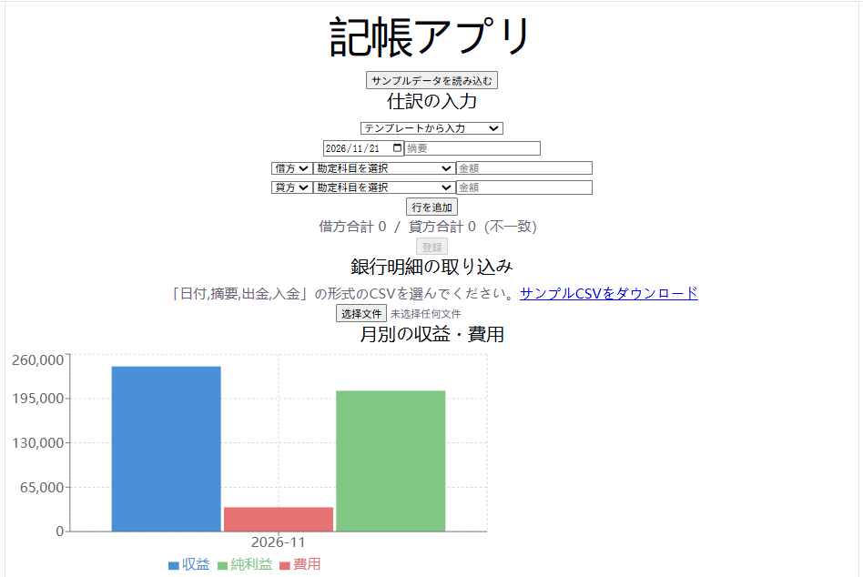
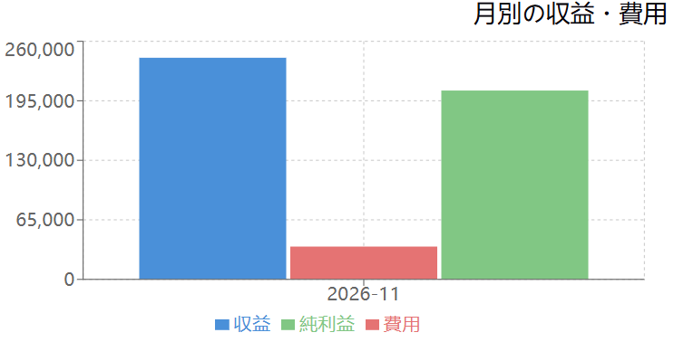

# ledger-api

個人事業主向けの複式簿記アプリです。仕訳を入力すると、借方と貸方が合っているかを自動でチェックして、試算表や損益計算書まで作ってくれます。

- デモ：https://ledger-frontend-5d86.onrender.com
- APIドキュメント：https://ledger-api-5uqs.onrender.com/docs
- 解説記事（Zenn）：[簿記のルールをコードで守る：複合仕訳・貸借一致チェック・訂正仕訳の設計](https://zenn.dev/burrata/articles/ssei-ledger-bookkeeping-rules)

デモは無料プランで公開しているため、しばらくアクセスがないと停止し、次のアクセス時の起動に1分ほどかかります。停止するとデータはサンプルデータの状態に戻るので、開いてすぐに動作を試せます。ログイン機能がなく誰でも書き込めるので、個人情報は入力しないでください。

開発期間：2026年10月〜11月





## なぜ作ったか

大学の会計の授業で、仕訳から試算表を手で集計するのにかなり時間がかかりました。この作業を自動でできれば楽になると思い、作り始めました。

## できること

- 仕訳の入力（テンプレートから選んだり、3行以上の複合仕訳も入力できます）
- 銀行明細のCSVを読み込んで、まとめて仕訳にする
- 試算表・損益計算書・貸借対照表・月別グラフの表示
- 借方と貸方が合わない仕訳や、存在しない勘定科目は登録できない
- 間違えた仕訳は消さずに、反対の仕訳で取り消す

## 使った技術

- フロントエンド：TypeScript、React、Vite
- バックエンド：Python、FastAPI、SQLAlchemy、SQLite
- テスト：pytest（36件）
- 公開：Render

## 設計で気をつけたこと

**仕訳を「本体」と「明細」に分けた**
1行に借方と貸方を1つずつ持たせる形だと、振込手数料を引かれた入金のように、科目が3つ以上ある仕訳を表せません。そこで、1つの仕訳に何行でも明細を持てるようにしました。

**貸借のチェックは画面・API・保存の直前で行う**
画面のチェックは入力する人がすぐ気づけるように、APIのチェックは間違ったリクエストを受け付けないためです。さらに、取消やCSV取り込みのようにAPIのバリデーションを通らない経路もあるので、データベースに書き込む直前（SQLAlchemyの`before_flush`）でも貸借の一致を確認しています。

**科目ごとに残高の向きを持たせた**
減価償却累計額や貸倒引当金は資産に分類されますが、残高は貸方に出ます。そこで、分類の既定値とは別に、科目ごとに残高の向きを設定できるようにしました。試算表の警告はこの向きで判定しています。

**存在しない勘定科目はデータベースでも拒否する**
勘定科目が登録済みかどうかはAPIで確認したうえで、データベースにも外部キー制約を付けています。SQLiteは外部キー制約を既定では検査しないため、接続するたびに有効にしています。

**仕訳は修正・削除できないようにした**
会計では、記帳した内容を消さずに訂正仕訳で直すのが原則なので、それに合わせました。

**銀行明細は、推測したあと人が確認してから登録する**
摘要のキーワードから勘定科目を推測していますが、必ず当たるわけではないので、登録する前に画面で直せるようにしました。同じ明細を2回読み込んでも、二重には登録されません。

## 苦労したこと

- **公開したら画面が真っ白になった**
  環境変数に設定したURLの最後に「/」を付けていたため、APIのURLが「//」になり、404エラーになっていました。ブラウザの開発者ツールでエラーを見て原因が分かりました。あわせて、1つのAPIでエラーが出ると画面全体が表示されなくなる作りになっていることにも気づいたので、今後直す予定です。
- **プロジェクトのフォルダを消してしまった**
  PCの整理中に誤って削除してしまいましたが、GitHubにこまめにpushしていたので、すぐに元に戻せました。
- **テーブルに列を追加したらエラーになった**
  既存のデータベースに新しい列がなかったのが原因でした。今はデータベースを作り直していますが、実際に使うサービスならマイグレーションの仕組みが必要だと分かりました。

## ローカルで動かす

```bash
# バックエンド
uv sync
uv run fastapi dev main.py

# フロントエンド（別のターミナルで）
cd frontend
npm install
npm run dev
```

テストは `uv run pytest -v` で実行できます。

## AIの使い方

設計の相談やコードの作成にClaude（生成AI）を使いました。提案されたコードは、画面で動かして確認し、テストを書いてから取り入れています。

## これからやりたいこと

- 総勘定元帳と、取消操作の画面
- 年度・期間を指定した財務諸表と、決算整理
- マイグレーションの仕組み（Alembicなど）の導入
- main.py を、モデル・スキーマ・APIごとのファイルに分ける
- 消費税の扱い
- エラー時の部分表示（Error Boundary）
- ログイン機能と、事業者ごとのデータの分離